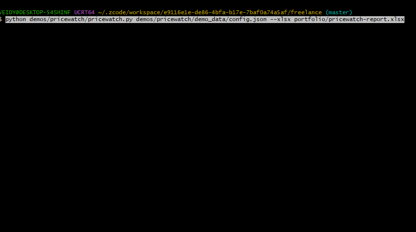
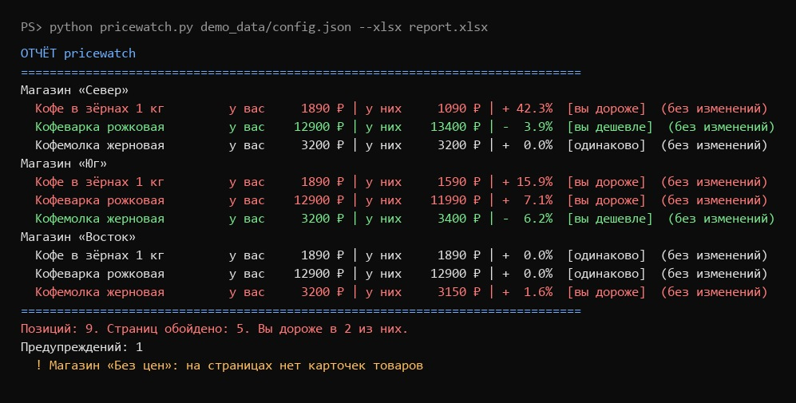
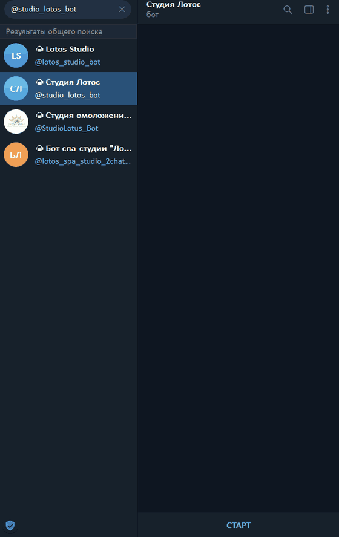
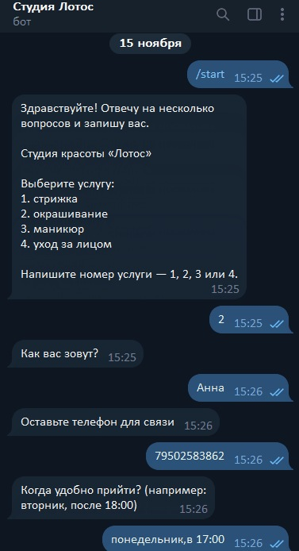
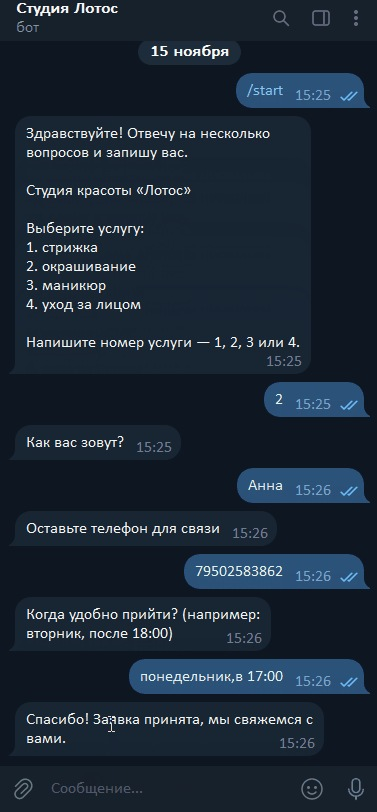

# Python: парсеры, Telegram-боты, автоматизация

**Сайт:** https://lagunovvova111-hash.github.io/python-portfolio/

Практические проекты на чистой стандартной библиотеке Python — без внешних
зависимостей, запускаются одной командой.

## Проекты

### 1. [pricewatch](pricewatch/) — мониторинг цен конкурентов

Собирает цены с нескольких сайтов, складывает историю в SQLite и выгружает
отчёт в Excel с цветовой подсветкой отклонений.




- обход пагинации, разбор карточек товаров через `html.parser`
- нормализация названий: «Кофеварка рожковая» и «кофеварка рожковая, 1 шт» — один товар
- расчёт отклонения от своей цены в процентах и определение «дороже/дешевле»
- устойчивость к сбоям: битый магазин не роняет прогон, попадает в предупреждения
- Excel собирается вручную (OOXML + zip), подсветка через условное форматирование

```bash
python pricewatch/pricewatch.py pricewatch/demo_data/config.json
```

### 2. [leadhook](leadhook/) — Telegram-бот приёма заявок

Бот для записи клиентов: меню услуг, пошаговый диалог, валидация телефона,
сохранение в CSV и уведомление владельцу.





- пошаговый конечный автомат состояний вместо «простыни» из `if`
- нормализация телефона к `+7XXXXXXXXXX` с отбраковкой мусора
- экспорт с защитой от дублей и записью в UTF-8 с BOM (Excel не ломает кириллицу)
- режим `--demo` для проверки логики без токена и без сети

```bash
python leadhook/leadhook.py --demo --export leads.csv
python leadhook/leadhook.py --token <BOT_TOKEN>
```

### 3. [browser-control](browser-control/) — управление браузером через CDP

Обёртка над Chrome DevTools Protocol: навигация, скриншоты, извлечение текста,
выполнение JS в уже запущенном браузере. Без Selenium и без WebDriver.

```bash
python browser-control/cdp.py nav https://example.com
python browser-control/cdp.py text
python browser-control/cdp.py shot page.png
```

## Стек

`Python 3.10+` · `sqlite3` · `html.parser` · `urllib` · `csv` · `zipfile`/OOXML ·
`Telegram Bot API` · `Chrome DevTools Protocol` · `Git`

Осознанно без pandas, requests и Selenium: разбор того, что обычно отдают
библиотекой, и понимание протоколов под ней.

## Структура

```
pricewatch/        парсер цен + отчёт в Excel
  demo_data/       офлайн-копии магазинов для запуска без сети
leadhook/          Telegram-бот приёма заявок
browser-control/   управление браузером через CDP
docs/              страница-визитка (GitHub Pages)
```

## Контакты

Telegram: [@veidyq](https://t.me/veidyq) · Email: lagunov.vova111@gmail.com
